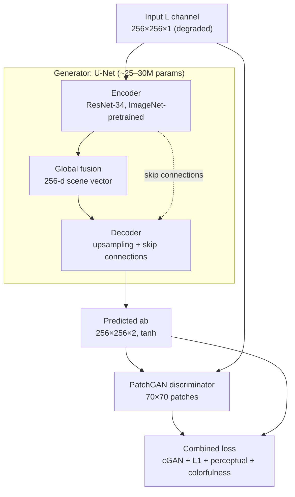

# Colorizing 1800s Portraits with a Conditional GAN

Automatic colorization of 19th-century portrait photographs (daguerreotypes, tintypes, cartes de visite) using a Pix2Pix-style conditional GAN in CIELAB space, trained on modern photos that are degraded to look like antique photographs.

> **Status:** In development. See [Tasks](#tasks) for progress.

---

## Table of Contents

- [Overview](#overview)
- [Why 1800s Portraits Are Hard](#why-1800s-portraits-are-hard)
- [Architecture](#architecture)
- [Data Pipeline](#data-pipeline)
- [Training](#training)
- [Inference](#inference)
- [Evaluation](#evaluation)
- [Datasets](#datasets)
- [Repository Structure](#repository-structure)
- [Data Contract](#data-contract)
- [Tasks](#tasks)
- [Related Work](#related-work)

---

## Overview

Given a grayscale portrait, the model predicts the two color channels (**a**, **b**) of the CIELAB color space from the lightness channel (**L**). The predicted color is then combined with the original L channel, so the output keeps the exact structure and detail of the input photo.

The model builds on **Pix2Pix** (Isola et al., CVPR 2017) and adds:

- A **pretrained ResNet-34 encoder** for better object and face recognition.
- A **global fusion layer** (from *Let There Be Color*, Iizuka et al., 2016) for consistent colors across the image.
- **Perceptual** and **colorfulness** losses (from ColorFormer and DDColor) to fight dull, desaturated output.
- A **period-specific training pipeline** that simulates blue-sensitive 1800s film and photo damage.

---

## Why 1800s Portraits Are Hard

| Problem | Why it matters | How we address it |
|---|---|---|
| **Blue-sensitive film** | Plates of the era were nearly blind to red light, so lips and cheeks look dark and wrinkles are exaggerated. | Simulate blue-sensitive grayscale when creating training inputs. |
| **Physical damage** | Scratches, fading, stains, noise, and blur do not exist in modern training photos. | Random synthetic degradation during training. |
| **No ground truth** | No true color versions of 1800s photos exist. | Metrics on degraded modern photos, plus visual evaluation on real 1800s portraits. |
| **Period mismatch** | Modern face datasets have modern clothing, makeup, and hairstyles. | Report as a limitation. Optional fine-tuning on MHMD (historical movie stills). |
| **Skin tone bias** | Face datasets are skewed toward lighter skin, and the film itself distorted skin tones. | Test on a diverse set of subjects and report findings. |
| **Desaturation** | Regression losses average plausible colors into brown or gray. | Adversarial, perceptual, and colorfulness losses. |

---

## Architecture



### Generator

A U-Net with a pretrained encoder and a global fusion layer at the bottleneck.

| Stage | Output size | Details |
|---|---|---|
| Input | 256×256×1 | L channel scaled to [-1, 1] |
| Encoder stage 1 | 128×128×64 | ResNet-34 stem (first conv adapted to 1 channel) |
| Encoder stage 2 | 64×64×64 | ResNet-34 layer 1 |
| Encoder stage 3 | 32×32×128 | ResNet-34 layer 2 |
| Encoder stage 4 | 16×16×256 | ResNet-34 layer 3 |
| Encoder stage 5 (bottleneck) | 8×8×512 | ResNet-34 layer 4 |
| Global fusion | 8×8×(512+256) | Global average pool → FC → 256-d vector, tiled and concatenated |
| Decoder | 16 → 32 → 64 → 128 → 256 | Upsampling blocks, each concatenated with the matching encoder skip |
| Dropout | n/a | 50% in the first 3 decoder blocks (as in Pix2Pix) |
| Output | 256×256×2 | 1×1 conv + tanh → ab in [-1, 1] |

Starting point in code:

```python
import segmentation_models_pytorch as smp

generator = smp.Unet(
    encoder_name="resnet34",
    encoder_weights="imagenet",
    in_channels=1,
    classes=2,
    activation=None,  # apply tanh in the forward pass
)
```

The global fusion layer requires a custom forward pass, either by wrapping this model or by writing our own decoder.

### Discriminator

A standard **70×70 PatchGAN** (Pix2Pix).

| Layer | Filters | Stride | Notes |
|---|---|---|---|
| Input | 3 | n/a | L concatenated with ab (conditional) |
| Conv 1 | 64 | 2 | LeakyReLU(0.2), no normalization |
| Conv 2 | 128 | 2 | BatchNorm + LeakyReLU |
| Conv 3 | 256 | 2 | BatchNorm + LeakyReLU |
| Conv 4 | 512 | 1 | BatchNorm + LeakyReLU |
| Output | 1 | 1 | 30×30 map, each value scores one 70×70 patch |

### Loss

```
L_G = L_cGAN + λ_L1 · L_L1 + λ_perc · L_perceptual + λ_cf · L_colorfulness
```

| Term | Purpose | Starting weight |
|---|---|---|
| `L_cGAN` | Realism, sharp detail | 1 |
| `L_L1` | Overall layout and average color | 100 (Pix2Pix default) |
| `L_perceptual` | VGG feature similarity | Tune (small) |
| `L_colorfulness` | Penalizes washed-out output | Tune (small; watch for orange skin) |

The discriminator loss is halved to slow its learning relative to the generator, following Pix2Pix.

---

## Data Pipeline

Training pairs are created from modern color photos:

```
color photo (RGB)
   ├── target:  RGB → Lab → ab channels                 (true colors)
   └── input:   RGB → film_gray() → degrade() → L       (looks like an 1800s photo)
```

**Important:** the input L comes from the simulated film grayscale, but the target ab comes from the true Lab of the original photo.

### Film simulation: `film_gray(rgb, mode)`

| Mode | Era | Approximate weighting |
|---|---|---|
| `blue` | Before ~1873 (daguerreotype, wet collodion, tintype) | Heavy blue, e.g. `0.1·R + 0.2·G + 0.7·B` |
| `ortho` | ~1873–1906 (orthochromatic) | Blue + green, little red |

Weights are starting points, to be tuned by comparing against real daguerreotypes. Era guidance follows Time-Travel Rephotography (Luo et al., 2021).

### Degradation: `degrade(img)`

Each effect is applied randomly with random strength:

- Gaussian blur
- Gaussian noise
- JPEG compression
- Reduced contrast and fading
- Vignetting
- Scratches and dust (procedural lines and spots, or texture overlays)

Recipe adapted from *Bringing Old Photos Back to Life* (Wan et al., CVPR 2020).

---

## Training

| Setting | Value |
|---|---|
| Resolution | 256×256 |
| Optimizer | Adam, lr = 2e-4, betas = (0.5, 0.999) |
| Weight init | Gaussian, std = 0.02 (non-pretrained layers) |
| Batch size | As large as GPU memory allows |
| Hardware | Colab / Kaggle GPU |

**Schedule:**

1. **L1 warm-up:** train the generator alone with L1 loss for a few epochs.
2. **Adversarial training:** enable the discriminator and the full loss.
3. **Fine-tuning (optional):** pretrain on colorful COCO images, then fine-tune on FFHQ.

**Rules:**

- Always support resuming from a checkpoint (Colab sessions disconnect).
- Save outputs on the [fixed sample set](#data-contract) after every experiment.
- If training becomes unstable, lower the learning rate and restart from the L1 warm-up checkpoint.

---

## Inference

Full-resolution colorization from a small model:

1. Load the original scan and convert it to grayscale. Keep this full-resolution **L**.
2. Resize a copy to 256×256 and run it through the generator.
3. Upsample the predicted **ab** back to the original resolution.
4. Combine the full-resolution L with the upsampled ab and convert to RGB.

Color carries much less detail than lightness, so this produces sharp results.

---

## Evaluation

**Quantitative** (on held-out degraded FFHQ faces), using the definitions of DDColor (Kang et al., ICCV 2023):

| Metric | Measures | Better |
|---|---|---|
| FID | Realism (distribution of deep features) | Lower |
| CF | Colorfulness | n/a (compare to real) |
| ΔCF | Gap between output and real colorfulness | Lower |
| PSNR | Pixel fidelity (rewards safe, averaged colors) | Higher |

**Qualitative** (on real 1800s portraits): side-by-side grids of the original, the blur-only Pix2Pix baseline, our model, and an off-the-shelf model (DDColor or DeOldify). Include failure cases.

**Ablation:** each model upgrade is one row in the results table.

| Experiment | Description |
|---|---|
| `baseline_blur` | Pix2Pix with blur-only augmentation |
| `baseline_degraded` | Pix2Pix with full film simulation + degradation |
| `+resnet` | Pretrained ResNet-34 encoder |
| `+warmup` | L1 warm-up before GAN training |
| `+perceptual` | VGG perceptual loss |
| `+fusion` | Global fusion layer |
| `+colorfulness` | Colorfulness loss (final model) |

---

## Datasets

| Dataset | Use | Notes |
|---|---|---|
| [FFHQ](https://github.com/NVlabs/ffhq-dataset) | Training (faces) | Resize to 256×256; ~18k train / 1k val / 1k test |
| [COCO](https://cocodataset.org/) | Optional pretraining | Filter for colorful images |
| [MHMD](https://github.com/BestiVictory/MHMD) | Optional (period clothing) | Access by request to the authors |
| [Library of Congress Daguerreotypes](https://www.loc.gov/pictures/collection/dag/) | Real test set | Public domain; remove hand-colored plates |
| [Smithsonian Open Access](https://www.si.edu/openaccess) | Real test set | National Portrait Gallery portraits |

---

## Repository Structure

```
.
├── configs/          # One YAML config per experiment
├── data/
│   ├── dataset.py    # PortraitDataset, lab_to_rgb()
│   ├── film.py       # film_gray()
│   └── degrade.py    # degrade()
├── models/
│   ├── generator.py
│   └── discriminator.py
├── losses/
│   ├── gan.py
│   ├── perceptual.py
│   └── colorfulness.py
├── samples/          # Outputs on the fixed sample set, one folder per experiment
├── train.py
├── eval.py           # FID, CF, ΔCF, PSNR → CSV
├── infer.py          # Full-resolution inference
└── README.md
```

---

## Data Contract

Agreed interface between data and model code. **Do not change without telling each other.**

- The dataset returns a dict: `{"L": Tensor[1, 256, 256], "ab": Tensor[2, 256, 256]}`
- Scaling: `L = L / 50 - 1`, `ab = ab / 110` (both in [-1, 1])
- Shared helper: `lab_to_rgb(L, ab)` converts model output back to an RGB image.
- **Fixed sample set:** 10 images (5 degraded FFHQ faces, 5 real daguerreotypes). Every experiment saves its outputs on these to `samples/<experiment_name>/`.
- **Experiment log:** `experiments.csv` with experiment name, config, date, metrics, and notes.

---

## Tasks

**Person A:** data, film simulation, evaluation
**Person B:** model and training

### Shared setup (both)

- [x] Create repo with the structure above
- [x] Agree on the [data contract](#data-contract)
- [ ] Choose the fixed sample set
- [x] Create the shared experiment log (`experiments.csv`)

### Person A: Data, film simulation, evaluation

**Phase 1: Baseline data**

- [x] **A1. Get FFHQ.** Download, resize to 256×256, split into train / val / test.
  *Done when:* folders and split files are available to both.
- [ ] **A2. Dataloader.** `PortraitDataset` (load RGB, random flip, convert to Lab, normalize) and `lab_to_rgb()`.
  *Done when:* B can iterate batches, and an RGB → Lab → RGB round-trip looks identical to the original.

**Phase 2: Making the data look old**

- [ ] **A3. Film grayscale.** `film_gray(rgb, mode)` with `blue` and `ortho` modes. Input L uses this; target ab uses true Lab.
  *Done when:* lips and cheeks look noticeably darker than with standard grayscale, as in real daguerreotypes.
- [ ] **A4. Degradation.** `degrade(img)` with random blur, noise, JPEG, contrast reduction, fading, vignetting, scratches, and dust.
  *Done when:* a grid of 16 degraded FFHQ faces next to 16 real daguerreotypes looks similar at a glance.
- [ ] **A5. Real test set.** 150–200 portraits from the Library of Congress and Smithsonian. Crop, convert to grayscale, normalize contrast, remove hand-colored plates, record year and process.
  *Done when:* a cleaned folder and a metadata CSV exist.

**Phase 3: Evaluation tools**

- [ ] **A6. Evaluation script.** `eval.py --ckpt X` computes FID, CF, ΔCF, PSNR on the validation set and writes a CSV.
  *Done when:* it produces sensible numbers for B's baseline checkpoint.
- [ ] **A7. Inference script.** `infer.py` for full-resolution colorization (see [Inference](#inference)).
  *Done when:* a large daguerreotype scan comes out sharp and colored.
- [ ] **A8. External comparisons.** Run DDColor or DeOldify on the real test set.
  *Done when:* outputs are saved alongside ours.

**Phase 4: Results**

- [ ] **A9. Figures and tables.** Ablation table from the experiment log; qualitative grid (original / blur baseline / ours / external).
- [ ] **A10. User study (optional).** ~10 people rate which colorization looks more natural.
- [ ] **A11. Writing.** Data, evaluation, and limitations sections of the report.

### Person B: Model and training

**Phase 1: Baseline model**

- [ ] **B1. Generator v0.** Standard Pix2Pix U-Net (8 down / 8 up, skips, dropout in first 3 decoder blocks, 1 → 2 channels, tanh).
- [ ] **B2. Discriminator.** 70×70 PatchGAN, 3-channel input, 30×30 output.
- [ ] **B3. Training loop.** Adam (2e-4, betas 0.5/0.999), λ_L1 = 100, halved D loss, loss logging, sample grids, checkpoint resume.
  *Done when:* trains on A2's clean data and produces colored faces.

**Phase 2: Training on old-looking data**

- [ ] **B4. Baseline runs.** Train `baseline_blur` (replicates the Smithsonian pix2pix project) and `baseline_degraded` (with A3 + A4).
  *Done when:* both checkpoints and sample outputs are saved.

**Phase 3: Model upgrades** (one at a time; each is a new experiment and ablation row)

- [ ] **B5.** Pretrained ResNet-34 encoder (`smp.Unet`)
- [ ] **B6.** L1 warm-up before GAN training
- [ ] **B7.** VGG perceptual loss
- [ ] **B8.** Global fusion layer at the bottleneck (custom forward pass)
- [ ] **B9.** Colorfulness loss; tune weight on the fixed sample set
- [ ] **B10. (Optional)** Two-stage training: colorful COCO, then FFHQ

**Phase 4: Final model**

- [ ] **B11. Final run.** Train the best config for longer; hand the checkpoint to A.
- [ ] **B12. Writing.** Method section of the report (architecture, losses, training details).

### Dependencies

| B needs from A | A needs from B |
|---|---|
| A2 dataloader → to start B3 | B3 checkpoint → to test A6 |
| A4 degradation → to run B4 | Each Phase 3 checkpoint → to run A6 |
| A5 test set → for visual checks | B11 final model → for A9 figures |

Until A2 is ready, B can develop with any folder of color photos and a temporary loader.

### Both

- [ ] Introduction and conclusion
- [ ] Review each other's sections
- [ ] Final presentation

---

## Related Work

**Models reviewed in our midterm report**

- R. Zhang, P. Isola, A. A. Efros. *Colorful Image Colorization.* ECCV 2016.
- S. Iizuka, E. Simo-Serra, H. Ishikawa. *Let There Be Color!* SIGGRAPH 2016.
- P. Isola, J.-Y. Zhu, T. Zhou, A. A. Efros. *Image-to-Image Translation with Conditional Adversarial Networks (Pix2Pix).* CVPR 2017.
- X. Ji et al. *ColorFormer: Image Colorization via Color Memory Assisted Hybrid-Attention Transformer.* ECCV 2022.
- X. Kang et al. *DDColor: Towards Photo-Realistic Image Colorization via Dual Decoders.* ICCV 2023.

**Work on old and historical photos**

- X. Luo et al. *Time-Travel Rephotography.* SIGGRAPH Asia 2021. Antique film simulation (blue-sensitive, orthochromatic, panchromatic).
- Z. Wan et al. *Bringing Old Photos Back to Life.* CVPR 2020. Old photo restoration and degradation modeling.
- X. Jin et al. *Focusing on Persons: Colorizing Old Images Learning from Modern Historical Movies (HistoryNet).* ACM MM 2021. MHMD dataset.
- *Creatives and AI collaborating: how a trained pix2pix model can help with colorization.* Towards Data Science, 2021. Pix2pix on Smithsonian portraits (our `baseline_blur`).
